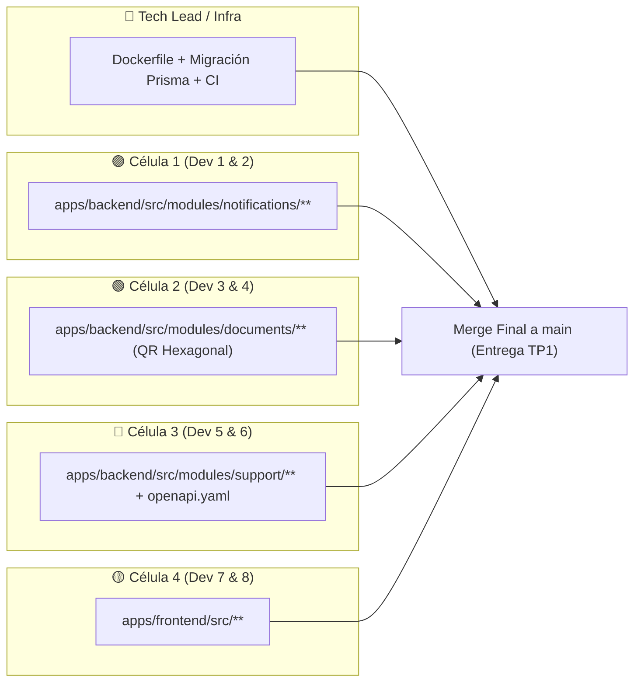

# Plan de Trabajo Paralelo y Tarjetas de Trello — Entrega TP1 (G10-M8)

> [!IMPORTANT]
> **Estado actual en `develop` (ya integrado):**
> - Se resolvió el merge de `origin/feat/m8-pdf-receipts` conservando íntegro `feat/m8-qr-generation`.
> - Se creó [`CommonModule`](file:///home/heberum/Projects/G10-M8/G10-M8/apps/backend/src/common/common.module.ts) (`@Global()`) para evitar múltiples instancias de `RedisService` y `PrismaService`.
> - Se corrigió [`RedisService`](file:///home/heberum/Projects/G10-M8/G10-M8/apps/backend/src/common/redis.service.ts) (soporte `REDIS_URL`, manejo de evento `error` en `ioredis`, `async onModuleInit()`, `getDel` atómico) y carga de `.env` en [`main.ts`](file:///home/heberum/Projects/G10-M8/G10-M8/apps/backend/src/main.ts).
> - **Pipeline actual:** `6 Test Suites Passed (43 tests)`, `lint` y `build` en verde.

---

## Mapa de Ejecución en Paralelo (Sin Bloqueos de Git)

Cada célula toca directorios distintos para evitar conflictos de merge al cerrar el día:

---

## 🟣 Célula 1: Notificaciones & Asincronismo (Dev 1 & Dev 2)

### Tarjeta 1.1
- **Título:** `[RF-8.1 / RF-8.2 / RF-8.6] Refactorizar módulo Notifications a Arquitectura Hexagonal y agregar Tests Unitarios`
- **Etiqueta:** 🟣 `Célula 1: Notificaciones`
- **Rama:** `feat/m8-notifications-hexagonal`
- **Archivos que toca (exclusivos de Célula 1):**
  - `apps/backend/src/modules/notifications/domain/ports/notification-sender.port.ts` *(nuevo)*
  - `apps/backend/src/modules/notifications/domain/ports/notification-log.repository.port.ts` *(nuevo)*
  - `apps/backend/src/modules/notifications/infrastructure/adapters/nodemailer-email.adapter.ts` *(nuevo)*
  - `apps/backend/src/modules/notifications/infrastructure/persistence/prisma-notification-log.repository.ts` *(nuevo)*
  - `apps/backend/src/modules/notifications/application/use-cases/send-notification.use-case.ts` *(nuevo)*
  - `apps/backend/src/modules/notifications/application/use-cases/send-notification.use-case.spec.ts` *(nuevo)*
  - `apps/backend/src/modules/notifications/infrastructure/controllers/notifications.controller.spec.ts` *(nuevo)*
- **Descripción:**
  - Actualmente [`NotificationsService`](file:///home/heberum/Projects/G10-M8/G10-M8/apps/backend/src/modules/notifications/application/notifications.service.ts) instancia `nodemailer` y llama a `PrismaService` directamente desde la capa de aplicación, incumpliendo **RNF-02** (Arquitectura Hexagonal) y no tiene tests unitarios (**RNF-07**).
  - Extraer el puerto de envío SMTP (`NotificationSenderPort`) y el puerto de persistencia (`NotificationLogRepositoryPort`), manteniendo intacta la firma pública de `NotificationsService.send()` para no romper `DocumentsModule` ni `SimulatorModule`.
- **Checklist (Definition of Done):**
  - [ ] Puertos creados en `domain/ports/` sin dependencias de NestJS ni Prisma.
  - [ ] Adaptador `NodemailerEmailAdapter` y repositorio `PrismaNotificationLogRepository` implementados en `infrastructure/`.
  - [ ] Reintentos controlados (`retryCount`) registrados en `NotificationLog` ante fallo de envío (RF-8.6).
  - [ ] Pruebas unitarias en `.spec.ts` para envío exitoso, fallo SMTP (registro `FAILED`) y consulta de historial (`GET /notifications/logs`).
  - [ ] `npm run test` y `npm run build` en verde.

---

## 🟢 Célula 2: Documentos & Seguridad QR/PDF (Dev 3 & Dev 4)

> [!NOTE]
> La parte de **Comprobantes PDF (`RF-8.4` y `RF-8.5`)** de la rama `feat/m8-pdf-receipts` ya quedó integrada en `develop` con sus 3 suites de tests. Solo resta desacoplar **QR (`RF-8.3`)** a puertos/casos de uso hexagonales y asegurar concurrencia atómica (**RNF-08**).

### Tarjeta 2.1
- **Título:** `[RF-8.3 / RNF-02 / RNF-08] Extraer Casos de Uso y Puertos Hexagonales para Generación y Verificación Atómica de QR`
- **Etiqueta:** 🟢 `Célula 2: Documentos & QR`
- **Rama:** `refactor/m8-qr-hexagonal`
- **Archivos que toca (exclusivos de Célula 2):**
  - `apps/backend/src/modules/documents/domain/ports/qr-token.repository.port.ts` *(nuevo)*
  - `apps/backend/src/modules/documents/application/use-cases/generate-qr.use-case.ts` *(nuevo)*
  - `apps/backend/src/modules/documents/application/use-cases/verify-qr.use-case.ts` *(nuevo)*
  - `apps/backend/src/modules/documents/infrastructure/persistence/prisma-qr-token.repository.ts` *(nuevo)*
  - `apps/backend/src/modules/documents/application/documents.service.ts`
  - `apps/backend/src/modules/documents/application/documents.service.spec.ts`
- **Descripción:**
  - Llevar la lógica de `generateQr` y `verifyQr` de [`DocumentsService`](file:///home/heberum/Projects/G10-M8/G10-M8/apps/backend/src/modules/documents/application/documents.service.ts) al mismo estándar hexagonal que ya tienen `RegisterReceiptUseCase` y `ResendReceiptUseCase`.
  - Utilizar `redis.getDel()` o actualización condicional en repositorio para garantizar que dos peticiones simultáneas de verificación no puedan consumir el mismo QR dos veces (RNF-08).
- **Checklist (Definition of Done):**
  - [ ] Puerto `QrTokenRepositoryPort` definido en `domain/ports/`.
  - [ ] Casos de uso `GenerateQrUseCase` y `VerifyQrUseCase` creados y delegados desde `DocumentsService`.
  - [ ] Consumo atómico validado con test unitario de concurrencia (doble invocación simultánea con `Promise.all` donde solo 1 retorna `200 OK` y la segunda lanza `410 Gone`).
  - [ ] Todos los tests de `documents` pasando (`npm run test`).

---

## 🔵 Célula 3: Soporte & Tickets (Dev 5 & Dev 6)

### Tarjeta 3.1
- **Título:** `[RF-8.7 / RNF-02 / RNF-07] Implementar Arquitectura Hexagonal, máquina de estados y Tests Unitarios en módulo Support`
- **Etiqueta:** 🔵 `Célula 3: Soporte & Tickets`
- **Rama:** `feat/m8-support-hexagonal-tests`
- **Archivos que toca (exclusivos de Célula 3):**
  - `apps/backend/src/modules/support/domain/ports/support-ticket.repository.port.ts` *(nuevo)*
  - `apps/backend/src/modules/support/infrastructure/persistence/prisma-support-ticket.repository.ts` *(nuevo)*
  - `apps/backend/src/modules/support/application/support.service.ts`
  - `apps/backend/src/modules/support/application/support.service.spec.ts` *(nuevo)*
  - `apps/backend/src/modules/support/infrastructure/controllers/support.controller.ts`
  - `apps/backend/src/modules/support/infrastructure/controllers/support.controller.spec.ts` *(nuevo)*
  - `packages/contracts/openapi.yaml` *(sección `/support/tickets`)*
- **Descripción:**
  - Corregir el generador de `ticketNumber` en [`SupportService.create`](file:///home/heberum/Projects/G10-M8/G10-M8/apps/backend/src/modules/support/application/support.service.ts#L13-L28): actualmente usa `this.ticketCounter = 1000` en memoria, lo que causa error de clave única (`@unique`) en base de datos al reiniciar el servidor. Cambiar a formato libre de colisiones (ej. `TCK-2026-${randomHex}` igual que `REC-2026-XXXXXX` en comprobantes).
  - Validar transiciones de estado válidas (`OPEN` -> `IN_PROGRESS` -> `RESOLVED` -> `CLOSED`, impidiendo reabrir un ticket `CLOSED` con `400 BadRequestException`).
  - Extraer `SupportTicketRepositoryPort` + `PrismaSupportTicketRepository`.
  - Documentar `GET /support/tickets/{ticketId}` y filtro query `referenceId`/`status` en [`openapi.yaml`](file:///home/heberum/Projects/G10-M8/G10-M8/packages/contracts/openapi.yaml#L168-L266).
- **Checklist (Definition of Done):**
  - [ ] Generación de `ticketNumber` sin colisiones al reiniciar el servicio.
  - [ ] Validación de transiciones de estado de tickets implementada.
  - [ ] Puerto y adaptador Prisma creados en `domain/` e `infrastructure/`.
  - [ ] Suite de pruebas unitarias `support.service.spec.ts` y `support.controller.spec.ts` creadas y pasando.
  - [ ] Contrato `openapi.yaml` actualizado con `GET /support/tickets/{ticketId}` y parámetros de filtro.

---

## 🟡 Célula 4: Frontend Backoffice & Usabilidad (Dev 7 & Dev 8)

### Tarjeta 4.1
- **Título:** `[RF-8.4 / RF-8.5 / RF-8.7] Conectar Dashboard React con API real de Tickets, Historial de Notificaciones y Descarga/Reenvío de PDF`
- **Etiqueta:** 🟡 `Célula 4: Frontend Backoffice`
- **Rama:** `feat/m8-frontend-api-integration`
- **Archivos que toca (exclusivos de Célula 4):**
  - `apps/frontend/src/App.tsx`
  - `apps/frontend/src/index.css`
- **Descripción:**
  - En [`App.tsx`](file:///home/heberum/Projects/G10-M8/G10-M8/apps/frontend/src/App.tsx):
    1. Reemplazar `const API_BASE = 'http://localhost:3000/api/v1'` por `import.meta.env.VITE_API_BASE_URL || 'http://localhost:3000/api/v1'` (RNF-06).
    2. Cargar inicialmente `GET /support/tickets` y `GET /notifications/logs` en el `useEffect` (manteniendo los datos demo como fallback si el backend está apagado).
    3. Agregar en la tabla de **Tickets (`RF-8.7`)** un selector/botón para cambiar el estado del ticket (`PATCH /support/tickets/:id/status`).
    4. Agregar en el panel **Simulador / Comprobantes (`RF-8.4 / RF-8.5`)** botones para probar en vivo el registro (`POST /documents/receipts`), la descarga directa del PDF (`GET /documents/receipts/:tripId/download`) y el reenvío por email (`POST /documents/receipts/resend`).
- **Checklist (Definition of Done):**
  - [ ] Uso de `import.meta.env.VITE_API_BASE_URL`.
  - [ ] Consulta real a `GET /support/tickets` y cambio de estado con `PATCH /support/tickets/:id/status`.
  - [ ] Consulta real a `GET /notifications/logs`.
  - [ ] Botón funcional para descargar PDF (`GET /documents/receipts/:tripId/download`) y reenviar por correo (`POST /documents/receipts/resend`).
  - [ ] `npm run build` compila `apps/frontend` sin errores de TypeScript.

---

## 🔴 Rol Transversal: Tech Lead, DevOps & QA Cross (Heber)

### Tarjeta TL.1
- **Título:** `[RNF-04 / RNF-05 / RNF-07] Agregar Dockerfile multi-stage, migración inicial de Prisma y endurecer CI en GitHub Actions`
- **Etiqueta:** 🔴 `Infra / Supabase / CI`
- **Rama:** `chore/m8-docker-prisma-ci`
- **Archivos que toca:**
  - `Dockerfile` *(nuevo en raíz o `apps/backend/Dockerfile`)*
  - `docker-compose.yml`
  - `apps/backend/prisma/migrations/**` *(nuevo)*
  - `.github/workflows/ci.yml`
- **Descripción:**
  - Crear `Dockerfile` reproducible (Node 20 Alpine) para el servicio M8 cumpliendo **RNF-04** (*"Cada módulo y dependencia deberá ejecutarse mediante imágenes OCI reproducibles y versionadas"*).
  - Generar y versionar la carpeta `apps/backend/prisma/migrations/` para dejar trazabilidad formal del esquema SQL (**RNF-05**).
  - Añadir el paso `npm run prisma:generate` en [`.github/workflows/ci.yml`](file:///home/heberum/Projects/G10-M8/G10-M8/.github/workflows/ci.yml) antes de `npm run lint` y `npm run test` para que GitHub Actions nunca falle por tipos de `@prisma/client` faltantes.
- **Checklist (Definition of Done):**
  - [ ] `Dockerfile` creado y servicio `m8-backend` documentado en `docker-compose.yml`.
  - [ ] Migración SQL inicial versionada en `apps/backend/prisma/migrations/`.
  - [ ] Paso `npm run prisma:generate` incluido en `.github/workflows/ci.yml`.
  - [ ] Merge final de `develop` -> `main` con todas las suites de pruebas en verde.
